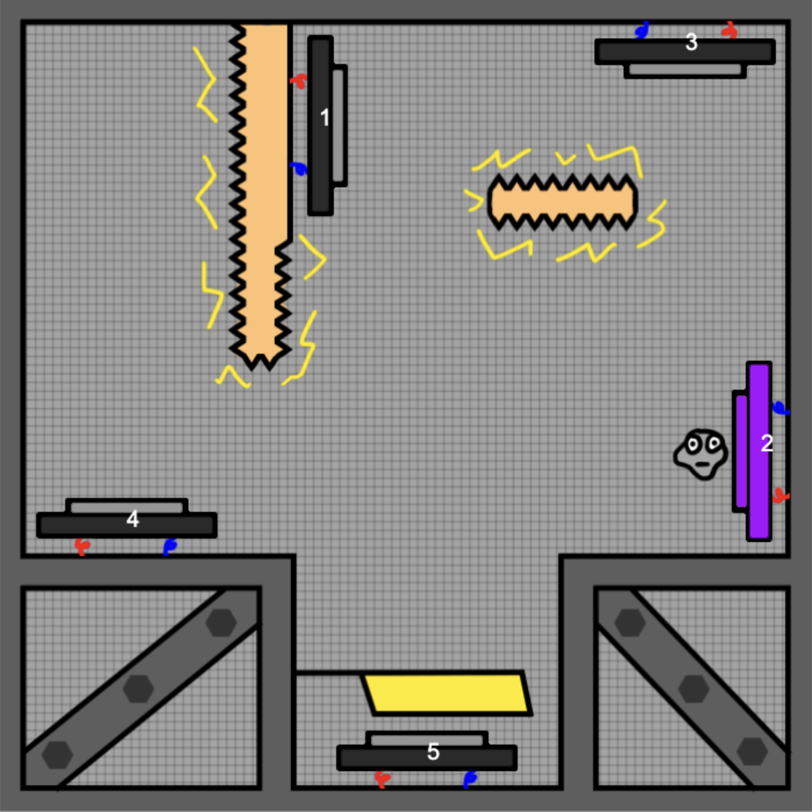
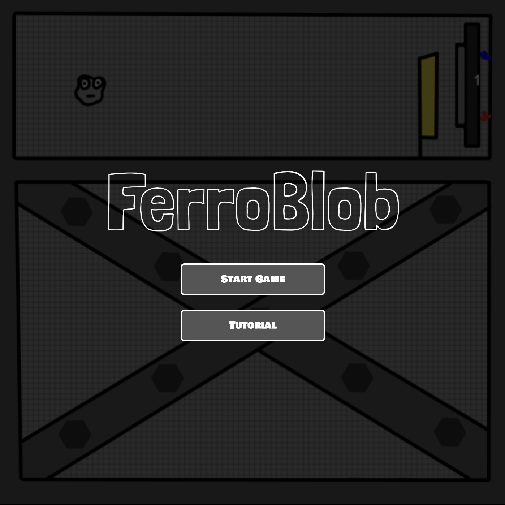

# 🎮 **FerroBlob** 

> **Short Pitch**:
> A cute puzzle game where you have to help a ferrofluid blob solve maze like tests by activating different magnets in a total of 8 levels

---

## 🌐 **Play the Game**
[Click here to play the game!](https://ccl1-bdb04e.pages.nwt.fhstp.ac.at/)

---

## 📸 **Screenshots**

### Main Gameplay:

  
  
*Figure 1: Example of gameplay in action.*

---

### Menu and UI:

  
  
*Figure 2: Menu and user interface.*

---

## 🎨 **Spritesheets**
Below are the sprites used to create characters and objects in the game:

### Player Character:

  
  
*Figure 3: Player character animations.*

---

### Enemies and NPCs:

  
  
*Figure 4: Enemy animations.*

---

## ✍️ **Reflection**

### What went well:
- **Game Design:** It was a very pleasing experience designing the eight levels and I really enjoyed it.
- **JS-Coding** As I am an already experienced JS programer, coding the game was a smooth experience with only minor hickups.

### Challenges:
- **Redoing Art Assets:** As I was already finished doing my art assets, I decided to redo them as I wasn't really satisfied with them in the first place.
- **Not Overdoing It:** I had so many more ideas for the game but decided to not overdo it for the purpose of playability and time constraints.

### Lessons Learned:
- **Personal Strengths:** I realized that my personal strenght definitly lay in gamedesign and programing.
- **Game Design:**  As I had a bit of a more complex game in mind in the first place, it was good to go back to the drawingboard and design the game in a way that was fun to play and easy to understand.